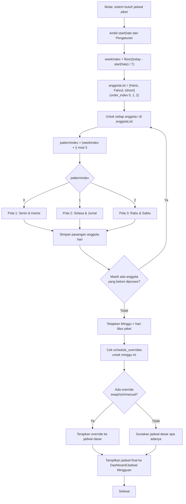
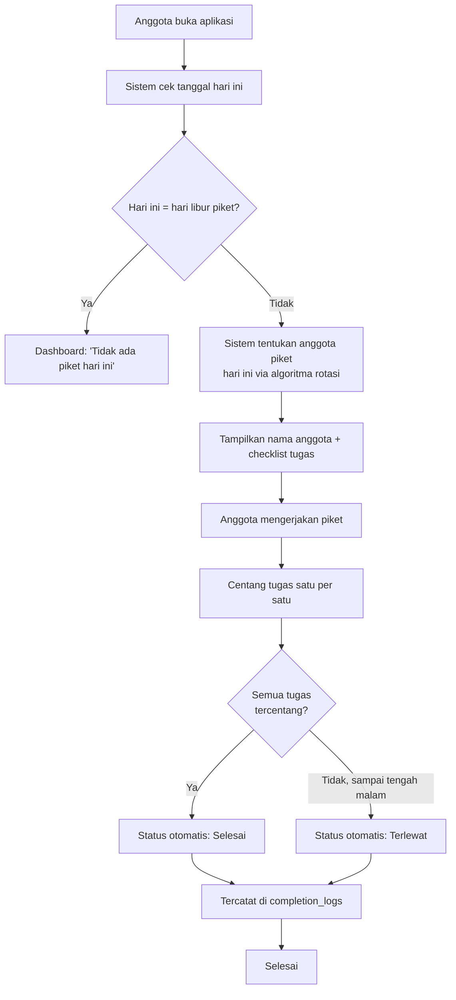

# PRD — KosPiket
## Sistem Jadwal Piket Otomatis

| Atribut | Detail |
|---|---|
| Versi | 2.1 |
| Status | Final |
| Platform | Web Responsive |
| Target Pengguna | Penghuni kost |
| Jumlah Anggota | 3 orang |
| Nama Anggota | Haris, Fahrul, Ishom |
| Frekuensi Piket | 2 kali per orang per minggu |
| Tanggal Dokumen | 5 September 2026 |

---

## 1. Ringkasan Produk

KosPiket adalah aplikasi web untuk mengatur jadwal kebersihan kost secara otomatis.

Aplikasi memiliki 3 anggota (Haris, Fahrul, Ishom). Setiap anggota mendapatkan 2 jadwal piket dalam satu minggu, sehingga terdapat:

- 3 anggota × 2 piket = **6 hari piket**
- 7 hari seminggu − 6 hari piket = **1 hari libur piket** (tidak ada jadwal untuk siapa pun)

Pengguna tidak perlu memilih jadwal sendiri. Sistem menentukan jadwal secara otomatis menggunakan algoritma rotasi yang adil, sehingga setiap anggota mendapat kombinasi hari yang setara dari minggu ke minggu.

---

## 2. Tujuan Produk

Aplikasi dibuat untuk menghilangkan kebutuhan menentukan jadwal piket secara manual di grup WhatsApp.

Pengguna cukup membuka aplikasi untuk mengetahui:

- Siapa yang piket hari ini.
- Tugas apa yang harus dilakukan.
- Siapa yang piket besok.
- Jadwal satu minggu penuh.
- Riwayat piket.

### Sasaran Keberhasilan (Success Criteria)

- Tidak ada lagi diskusi manual "hari ini siapa piket?" di grup chat.
- Jadwal terasa adil — dalam siklus 3 minggu, setiap anggota merasakan ketiga pola hari piket yang tersedia.
- Anggota bisa mengecek status piket dari HP dalam < 5 detik sejak membuka aplikasi.

---

## 3. Definisi & Istilah

| Istilah | Arti |
|---|---|
| Piket | Tugas kebersihan kost pada hari tertentu |
| Anggota | Penghuni kost yang terdaftar (tetap 3 orang di v1: Haris, Fahrul, Ishom) |
| Pola Hari | Pasangan 2 hari piket yang diberikan ke satu anggota dalam seminggu |
| Hari Libur Piket | 1 hari dalam seminggu tanpa kewajiban piket untuk siapa pun |
| Tukar Jadwal | Pertukaran hari piket antar 2 anggota |
| Izin | Penandaan bahwa anggota berhalangan piket pada tanggal tertentu |
| Siklus Rotasi | Periode 3 minggu sampai pola hari kembali ke anggota yang sama |

---

## 4. Target Pengguna

**Persona: Penghuni Kost**
- 3 orang yang tinggal serumah/sekost (Haris, Fahrul, Ishom), saling kenal, memakai HP sebagai alat utama.
- Ingin kepastian jadwal tanpa perlu nego atau voting manual.
- Butuh sistem yang bisa dibuka bersama (bukan aplikasi personal per akun terpisah, tapi satu sumber data yang sama untuk ketiganya).

Tidak ada peran "admin kost" formal yang terpisah dari anggota — di v1, ketiga anggota punya akses setara, salah satu bisa berperan mengatur pengaturan awal.

---

## 5. Ruang Lingkup

### Termasuk (In Scope v1)
- Generate jadwal piket otomatis berbasis algoritma rotasi.
- Dashboard: piket hari ini & besok.
- Tampilan jadwal 1 minggu penuh.
- Daftar tugas per hari piket.
- Riwayat piket (selesai/terlewat).
- Konfirmasi piket selesai.
- Tukar jadwal antar anggota.
- Penandaan izin/berhalangan.
- Reminder sederhana (in-app / browser notification).
- Pengaturan dasar: nama anggota, tanggal mulai, hari libur piket.

### Tidak Termasuk (Out of Scope v1)
- Pengelolaan keuangan/patungan kost.
- Multi-kost / multi-tenant (aplikasi ini untuk 1 kost dengan 3 anggota tetap).
- Jumlah anggota dinamis yang mengubah rasio 2 piket/minggu secara otomatis (lihat bagian 13 untuk penanganan perubahan anggota).
- Integrasi pembayaran atau sistem denda otomatis.
- Native mobile app (cukup web responsive).

---

## 6. Aturan Bisnis Inti & Algoritma Rotasi Piket

Ini adalah bagian inti dari produk.

### 6.1 Prinsip Dasar

- 7 hari dalam seminggu dibagi menjadi **3 pola hari** (masing-masing 2 hari, tidak berurutan) + **1 hari libur**.
- Hari tidak berurutan dipilih supaya beban piket tersebar merata dalam seminggu, bukan menumpuk di 2 hari berdekatan.

**Pembagian default:**

| Pola | Hari |
|---|---|
| Pola 1 | Senin & Kamis |
| Pola 2 | Selasa & Jumat |
| Pola 3 | Rabu & Sabtu |
| Libur | Minggu |

> Hari libur piket dapat diubah lewat Pengaturan (misalnya jika kost punya kebiasaan lain), tapi default-nya Minggu.

### 6.2 Rotasi Antar Minggu

Setiap minggu, pola hari digeser satu posisi ke anggota berikutnya, sehingga dalam **3 minggu (1 siklus penuh)**, setiap anggota sudah pernah mendapat ketiga pola hari secara merata.

**Anggota (order_index tetap): 0 = Haris, 1 = Fahrul, 2 = Ishom**

| Minggu | Haris | Fahrul | Ishom |
|---|---|---|---|
| 1 | Pola 1 (Sen, Kam) | Pola 2 (Sel, Jum) | Pola 3 (Rab, Sab) |
| 2 | Pola 2 (Sel, Jum) | Pola 3 (Rab, Sab) | Pola 1 (Sen, Kam) |
| 3 | Pola 3 (Rab, Sab) | Pola 1 (Sen, Kam) | Pola 2 (Sel, Jum) |
| 4 | (siklus ulang seperti Minggu 1) | | |

### 6.3 Pseudocode Algoritma

```
PATTERNS = [
  ["Senin", "Kamis"],
  ["Selasa", "Jumat"],
  ["Rabu", "Sabtu"]
]
HARI_LIBUR = "Minggu"
ANGGOTA = ["Haris", "Fahrul", "Ishom"]  # order_index 0, 1, 2

function getJadwalMinggu(weekIndex, anggotaList):
  # anggotaList = urutan tetap [Haris, Fahrul, Ishom] berdasarkan order_index
  jadwal = {}
  for i in range(len(anggotaList)):
    patternIndex = (weekIndex + i) % 3
    jadwal[anggotaList[i]] = PATTERNS[patternIndex]
  return jadwal

function getWeekIndex(today, startDate):
  return floor((today - startDate).days / 7)
```

`startDate` disimpan di Pengaturan saat setup pertama kali (dianggap sebagai Minggu ke-0 / titik awal siklus).

### 6.4 Tugas Piket per Hari

Setiap hari piket punya checklist tugas standar, contoh:

| Hari | Tugas |
|---|---|
| Hari piket biasa | Sapu & pel ruang bersama, buang sampah |
| Sabtu (akhir pola 3) | Tambahan: bersihkan kamar mandi umum |

Checklist ini dapat diedit lewat Pengaturan → Daftar Tugas, dan berlaku sama untuk siapa pun yang piket di hari tersebut (tugas melekat pada hari, bukan pada orang).

### 6.5 Prinsip Keadilan Jangka Panjang

- Rotasi 3-mingguan menjamin keadilan pola hari (bukan cuma jumlah hari, tapi jenis harinya — termasuk akhir pekan).
- Jika terjadi izin/tukar jadwal yang membuat distribusi timpang, sistem mencatatnya di riwayat agar terlihat transparan (lihat bagian 7.6 dan 13).

---

## 7. Kebutuhan Fungsional

### 7.1 Dashboard Utama
**Deskripsi:** Halaman pertama yang dibuka, menampilkan piket hari ini dan besok.
**User story:** "Sebagai penghuni kost, saya ingin langsung tahu siapa piket hari ini begitu buka aplikasi."
**Acceptance criteria:**
- Menampilkan nama anggota piket hari ini (Haris/Fahrul/Ishom) + checklist tugas.
- Menampilkan nama anggota piket besok.
- Menampilkan status: belum mulai / selesai.
- Jika hari ini adalah hari libur piket, tampilkan indikator "Tidak ada piket hari ini".

### 7.2 Jadwal Mingguan
**Deskripsi:** Tampilan 7 hari (Senin–Minggu) dengan nama anggota di tiap hari.
**Acceptance criteria:**
- Bisa navigasi ke minggu sebelumnya/berikutnya.
- Hari ini ditandai secara visual (highlight).
- Menampilkan pola hari libur.

### 7.3 Detail Tugas Piket per Hari
**Deskripsi:** Saat hari piket dibuka, tampil checklist tugas untuk hari tersebut.
**Acceptance criteria:**
- Checklist bisa dicentang satu per satu.
- Semua tugas tercentang → status hari itu otomatis "Selesai".

### 7.4 Riwayat Piket
**Deskripsi:** Log piket per anggota: tanggal, status (selesai/terlewat/izin/ditukar).
**Acceptance criteria:**
- Filter berdasarkan anggota (Haris/Fahrul/Ishom) dan rentang tanggal.
- Menampilkan ringkasan: total piket selesai vs terlewat per anggota.

### 7.5 Tukar Jadwal (Swap)
**Deskripsi:** Anggota dapat menukar hari piketnya dengan anggota lain.
**User story:** "Saya ada acara hari Kamis, saya mau tukar dengan hari piket teman saya."
**Acceptance criteria:**
- Pilih tanggal sendiri → pilih anggota tujuan → pilih tanggal milik anggota tujuan.
- Anggota tujuan menerima notifikasi permintaan tukar.
- Setelah disetujui, jadwal kedua tanggal otomatis terbalik dan tercatat di riwayat sebagai "Ditukar".

### 7.6 Izin / Tidak Bisa Piket
**Deskripsi:** Anggota menandai dirinya berhalangan pada tanggal tertentu tanpa harus ada pengganti langsung.
**Acceptance criteria:**
- Status tanggal tersebut berubah menjadi "Izin".
- Sistem menyarankan opsi tukar jadwal ke anggota lain (opsional, tidak wajib).
- Tercatat di riwayat untuk transparansi.

### 7.7 Konfirmasi Piket Selesai
**Deskripsi:** Anggota menandai piket sudah selesai dikerjakan.
**Acceptance criteria:**
- Tombol "Tandai Selesai" hanya aktif pada hari piket berjalan.
- Setelah lewat tengah malam tanpa konfirmasi, status otomatis menjadi "Terlewat".

### 7.8 Notifikasi & Reminder
**Deskripsi:** Pengingat piket hari ini/besok.
**Acceptance criteria:**
- Reminder in-app saat aplikasi dibuka.
- (Opsional v1, wajib jika memungkinkan) Browser push notification pagi hari.

### 7.9 Manajemen Anggota
**Deskripsi:** Pengaturan 3 nama anggota tetap (default: Haris, Fahrul, Ishom).
**Acceptance criteria:**
- Bisa mengubah nama/foto anggota.
- Anggota tidak bisa ditambah/dikurangi tanpa memengaruhi algoritma (lihat bagian 13.4).

### 7.10 Pengaturan Umum
**Deskripsi:** Konfigurasi dasar aplikasi.
**Acceptance criteria:**
- Atur tanggal mulai siklus (`startDate`).
- Atur hari libur piket (default Minggu).
- Atur/edit daftar tugas per hari.

---

## 8. Alur Pengguna (User Flow)

**Flow harian:**
Buka aplikasi → Dashboard menampilkan piket hari ini → buka checklist tugas → centang tugas → tandai selesai.

**Flow tukar jadwal:**
Buka Jadwal Mingguan → pilih tanggal sendiri → tombol "Tukar" → pilih anggota & tanggal tujuan → kirim permintaan → anggota tujuan menerima notifikasi → setuju/tolak → jadwal terupdate.

**Flow setup awal (onboarding):**
Buka aplikasi pertama kali → isi 3 nama anggota (Haris, Fahrul, Ishom) → tentukan urutan → tentukan tanggal mulai (startDate) → konfirmasi hari libur piket (default Minggu) → sistem generate jadwal minggu berjalan.

---

## 8A. Flowchart

Diagram alur berikut melengkapi Bagian 6 (Algoritma Rotasi) dan Bagian 8 (User Flow) secara visual.

### 8A.1 Flowchart — Algoritma Rotasi Jadwal Piket



### 8A.2 Flowchart — Alur Harian Piket



### 8A.3 Flowchart — Alur Tukar Jadwal (Swap)

```mermaid
flowchart TD
    A[Anggota A buka Jadwal Mingguan] --> B[Pilih tanggal piket sendiri]
    B --> C[Tekan tombol 'Tukar']
    C --> D[Pilih anggota tujuan\n(Haris/Fahrul/Ishom)]
    D --> E[Pilih tanggal piket milik anggota tujuan]
    E --> F[Kirim permintaan tukar\n-> swap_requests: status pending]
    F --> G[Anggota tujuan menerima notifikasi]
    G --> H{Anggota tujuan\nsetuju?}
    H -->|Setuju| I[status = approved]
    H -->|Tolak| J[status = rejected]
    I --> K[Jadwal kedua tanggal terbalik]
    K --> L[Tercatat di riwayat sebagai 'Ditukar']
    J --> M[Jadwal tetap seperti semula]
    L --> N[Selesai]
    M --> N
```

---

## 9. Kebutuhan Non-Fungsional

| Aspek | Kebutuhan |
|---|---|
| Responsive | Mobile-first, karena mayoritas akses lewat HP; tetap nyaman di desktop. |
| Performa | Dashboard dimuat < 2 detik pada koneksi normal. |
| Sinkronisasi | Data harus real-time/near-real-time antar 3 anggota (satu sumber data bersama, bukan tersimpan lokal per perangkat). |
| Ketersediaan | Aplikasi dapat diakses 24/7, cocok untuk hosting gratis/murah skala kecil. |
| Keamanan | Autentikasi ringan (misal pilih nama + PIN 4 digit) cukup untuk skala 3 pengguna; tidak perlu sistem akun kompleks. |
| Aksesibilitas | Kontras warna cukup, ukuran tombol nyaman disentuh di layar kecil. |

---

## 10. Struktur Data (Data Model)

| Tabel | Field Utama |
|---|---|
| `members` | id, name, order_index (0/1/2), avatar_color, status_aktif, joined_at |
| `settings` | start_date, hari_libur, nama_kost |
| `tasks` | id, name, description, applies_to_day, frequency |
| `schedule_overrides` | id, date, original_member_id, new_member_id, reason (swap/izin/manual), created_at |
| `completion_logs` | id, date, member_id, status (selesai/belum/terlewat/izin/ditukar), completed_at, note |
| `swap_requests` | id, requester_id, target_member_id, date_requester, date_target, status (pending/approved/rejected), created_at |

> Catatan: jadwal default tidak perlu disimpan permanen karena bisa dihitung ulang kapan saja dari algoritma (bagian 6.3). Yang disimpan hanya *pengecualian* (`schedule_overrides`) dan *log aktivitas* (`completion_logs`).

**Contoh isi awal tabel `members` (seed data v1):**

| id | name | order_index | status_aktif |
|---|---|---|---|
| 1 | Haris | 0 | true |
| 2 | Fahrul | 1 | true |
| 3 | Ishom | 2 | true |

---

## 11. Rancangan Antarmuka (Gambaran Wireframe)

| Halaman | Elemen Utama |
|---|---|
| Dashboard | Kartu "Piket Hari Ini" (besar, atas), kartu "Piket Besok" (kecil), checklist tugas |
| Jadwal Mingguan | Tabel/list 7 hari, navigasi minggu, highlight hari ini |
| Riwayat | List log per tanggal, filter anggota & rentang waktu, ringkasan statistik |
| Tukar Jadwal | Form 2 langkah: pilih tanggal sendiri → pilih tanggal tujuan |
| Pengaturan | Form nama anggota, tanggal mulai, hari libur, daftar tugas |

---

## 12. Rekomendasi Tech Stack

| Layer | Rekomendasi | Alasan |
|---|---|---|
| Frontend | Next.js (React) + Tailwind CSS | Cepat dibangun, responsive by default |
| Backend & Database | Supabase (Postgres + Auth + Realtime) | Gratis untuk skala kecil, realtime sync cocok untuk 3 pengguna berbagi data |
| Hosting | Vercel | Deploy langsung dari repo, gratis untuk skala kecil |
| Notifikasi | Web Push API (built-in browser) | Tidak perlu infrastruktur tambahan; integrasi WhatsApp (mis. Fonnte/WA Business API) bisa jadi opsi fase lanjutan |

---

## 13. Penanganan Kasus Khusus (Edge Cases)

**13.1 Anggota izin mendadak**
Ditandai "Izin" (7.6). Piket hari itu tidak otomatis dilimpahkan — dicatat di riwayat sebagai transparansi, anggota lain bisa menawarkan bantuan manual via fitur tukar.

**13.2 Anggota lupa konfirmasi**
Setelah lewat hari, status otomatis "Terlewat" dan tetap tampil di riwayat (tidak dihapus), agar terlihat pola kedisiplinan.

**13.3 Ada libur nasional / acara kost**
Ditangani manual lewat `schedule_overrides` dengan reason "manual" — di v1 tidak ada logika otomatis untuk hari libur nasional.

**13.4 Jumlah anggota berubah dari 3**
Algoritma di bagian 6 dirancang khusus untuk 3 anggota × 2 pola hari. Jika jumlah anggota kost berubah, aturan rasio 2 piket/minggu dan pembagian pola hari perlu dikonfigurasi ulang secara manual (di luar cakupan v1) — dicatat sebagai catatan pengembangan untuk versi berikutnya, bukan kebutuhan v1.

---

## 14. Metrik Keberhasilan (KPI)

- % piket berstatus "Selesai" tepat waktu per minggu.
- Jumlah penggunaan fitur tukar jadwal per bulan (indikator fleksibilitas terpakai).
- Frekuensi buka aplikasi per anggota per minggu (indikator adopsi).
- Penurunan diskusi manual soal piket di grup chat (indikator kualitatif, self-report).

---

## 15. Roadmap Pengembangan

**Fase 1 — MVP**
- Algoritma rotasi otomatis
- Dashboard, jadwal mingguan, checklist tugas
- Riwayat piket dasar
- Pengaturan awal (setup 3 anggota, startDate, hari libur)

**Fase 2**
- Tukar jadwal antar anggota
- Fitur izin
- Reminder/notifikasi in-app & push

**Fase 3**
- Integrasi reminder ke WhatsApp
- Statistik & badge sederhana (gamifikasi kedisiplinan)
- Dukungan penyesuaian jumlah anggota yang lebih fleksibel

---

## 16. Risiko & Mitigasi

| Risiko | Mitigasi |
|---|---|
| Anggota tidak buka aplikasi sama sekali | Reminder push + tampilan sederhana agar cepat dicek |
| Data tidak sinkron antar perangkat | Gunakan backend realtime (Supabase), hindari penyimpanan lokal saja |
| Perselisihan soal tukar jadwal | Semua tukar tercatat dengan timestamp & status approval di riwayat, transparan untuk semua anggota |
| Kompleksitas algoritma dianggap membingungkan | Tampilkan jadwal hasil akhir secara sederhana di UI; logika rotasi cukup berjalan di backend, tidak perlu dijelaskan ke pengguna |

---

## 17. Lampiran: Contoh Jadwal 3 Minggu Penuh

| Hari | Minggu 1 | Minggu 2 | Minggu 3 |
|---|---|---|---|
| Senin | Haris | Ishom | Fahrul |
| Selasa | Fahrul | Haris | Ishom |
| Rabu | Ishom | Fahrul | Haris |
| Kamis | Haris | Ishom | Fahrul |
| Jumat | Fahrul | Haris | Ishom |
| Sabtu | Ishom | Fahrul | Haris |
| Minggu | *Libur* | *Libur* | *Libur* |

*(Minggu ke-4 mengulang pola Minggu 1, dan seterusnya.)*

## 18. TACH STACK
Untuk aplikasi KosPiket,  pakai:


Frontend: Next.js + React
Styling: Tailwind CSS
Backend: Supabase
Database: PostgreSQL melalui Supabase
Authentication: Supabase Auth atau PIN sederhana sesuai kebutuhan aplikasi
Realtime: Supabase Realtime
Hosting: Vercel
ARSITEKTUR

Gunakan Supabase sebagai backend utama / Backend as a Service (BaaS).

JANGAN membuat backend terpisah menggunakan:

Node.js + Express
MySQL
MongoDB
Firebase
server custom lainnya

## ATURAN PENTINGGGG!!!!
Kamu bertindak sebagai **Senior Software Engineer dan Software Architect** yang berpengalaman dalam membangun aplikasi web production-ready.

Saya sedang mengembangkan aplikasi bernama **KosPiket** menggunakan:

* Frontend: Next.js + React
* Styling: Tailwind CSS
* Backend: Supabase
* Database: PostgreSQL (Supabase)
* Authentication: Supabase Auth
* Realtime: Supabase Realtime
* Deployment: Vercel

Tugasmu adalah menulis dan mengembangkan kode aplikasi dengan **standar profesional**, bukan sekadar membuat kode yang bisa berjalan.

## 1. Prinsip Utama Coding

Setiap kode yang kamu buat harus:

* Clean Code
* Readable
* Maintainable
* Scalable
* Modular
* Reusable
* Secure
* Konsisten
* Mudah dipahami programmer lain
* Mudah dikembangkan oleh saya di masa depan
* Tidak memiliki duplikasi kode yang tidak diperlukan
* Tidak membuat arsitektur menjadi rumit tanpa alasan

Gunakan prinsip:

* SOLID jika memang relevan
* DRY (Don't Repeat Yourself)
* KISS (Keep It Simple)
* Separation of Concerns
* Single Responsibility
* Composition over unnecessary inheritance

**Jangan menggunakan OOP hanya karena terlihat profesional.**
Gunakan pendekatan yang paling sesuai dengan Next.js dan React. Functional programming dan React functional components lebih diutamakan jika memang lebih sederhana.

---

## 2. Struktur Project

Gunakan struktur folder yang jelas dan memiliki tanggung jawab masing-masing.

Contoh:

```text
src/
├── app/
│   ├── page.tsx
│   ├── login/
│   ├── dashboard/
│   └── ...
│
├── components/
│   ├── ui/
│   ├── layout/
│   ├── schedule/
│   └── members/
│
├── lib/
│   ├── supabase/
│   ├── utils/
│   └── constants/
│
├── services/
│   ├── member.service.ts
│   ├── schedule.service.ts
│   └── ...
│
├── hooks/
│   ├── useMembers.ts
│   ├── useSchedule.ts
│   └── ...
│
├── types/
│   ├── member.ts
│   ├── schedule.ts
│   └── database.ts
│
└── ...
```

Sesuaikan struktur jika kebutuhan aplikasi berubah.

Jangan membuat folder atau file hanya untuk terlihat banyak.
Setiap file harus memiliki alasan dan tanggung jawab yang jelas.

---

## 3. Aturan Component React

Component harus:

* Memiliki satu tanggung jawab utama
* Tidak terlalu panjang
* Tidak mencampurkan UI, database query, dan business logic dalam satu file
* Menggunakan reusable components jika ada bagian yang digunakan berulang
* Menggunakan props dengan nama yang jelas
* Menghindari prop drilling yang tidak diperlukan
* Menghindari component yang terlalu besar

Jika sebuah component sudah terlalu kompleks, pecah menjadi beberapa component yang lebih kecil.

Contoh:

```text
SchedulePage
├── ScheduleHeader
├── WeekSelector
├── ScheduleCalendar
│   └── ScheduleCard
└── ScheduleActions
```

---

## 4. Business Logic

Pisahkan business logic dari UI.

Jangan melakukan seluruh proses seperti:

```text
UI
↓
Database query
↓
Validasi
↓
Algoritma
↓
Update database
```

di dalam satu component.

Gunakan pemisahan:

```text
Component
    ↓
Hook / Action
    ↓
Service
    ↓
Supabase
```

Business logic yang penting seperti algoritma rotasi jadwal harus berada di tempat yang mudah diuji dan dikembangkan.

---

## 5. Database

Gunakan Supabase PostgreSQL secara terstruktur.

Pisahkan:

* Database schema
* Query
* Business logic
* UI

Gunakan TypeScript type untuk data database.

Jangan menulis query database secara sembarangan di banyak component.

Jika query digunakan berulang, buat fungsi/service yang reusable.

---

## 6. TypeScript

Gunakan TypeScript secara maksimal.

Hindari:

```typescript
any
```

kecuali benar-benar diperlukan dan jelaskan alasannya.

Gunakan:

```typescript
type
interface
enum
union type
generic
```

jika memang membuat kode lebih aman dan mudah dipahami.

Semua function penting harus memiliki tipe parameter dan return value yang jelas.

---

## 7. Naming Convention

Gunakan nama yang deskriptif.

Hindari:

```typescript
data
x
temp
foo
test
handle
process
```

jika nama tersebut tidak menjelaskan tujuan sebenarnya.

Lebih baik:

```typescript
members
weeklySchedules
selectedDate
generateWeeklySchedule()
updateScheduleStatus()
```

Nama file, function, variable, component, dan database field harus konsisten.

---

## 8. Error Handling

Setiap proses yang berhubungan dengan:

* Supabase
* Authentication
* Database
* API
* Form
* Network request

harus memiliki error handling yang jelas.

Jangan menggunakan:

```typescript
try {
  ...
} catch (error) {}
```

tanpa penanganan.

Berikan:

* Error message yang jelas
* Logging yang sesuai
* Loading state
* Empty state
* Error state

---

## 9. Security

Jangan pernah menaruh:

* API secret
* Service role key
* Password
* Credential
* Secret key

langsung di frontend atau source code.

Gunakan environment variables.

Untuk Supabase, gunakan **Row Level Security (RLS)** dengan benar.

Jangan menganggap frontend sebagai tempat yang aman untuk authorization.

Validasi permission tetap harus dilakukan di server/database.

---

## 10. Performance

Jangan melakukan optimasi berlebihan sebelum diperlukan.

Namun hindari:

* Query database berulang
* Fetch data yang tidak diperlukan
* Infinite re-render
* Component rendering yang tidak perlu
* Duplikasi request
* Import library besar tanpa alasan

Gunakan caching, memoization, pagination, atau optimasi lainnya hanya jika memang dibutuhkan.

---

## 11. Dokumentasi Kode

Jangan memberikan komentar pada setiap baris kode.

Komentar hanya digunakan jika menjelaskan:

* Alasan suatu keputusan
* Business rule
* Algoritma yang kompleks
* Perilaku yang tidak obvious

Komentar harus menjelaskan **WHY**, bukan hanya **WHAT**.

Buruk:

```typescript
// Loop members
members.forEach(...)
```

Lebih baik:

```typescript
// Members are rotated weekly to prevent the same person
// from repeatedly receiving the same weekday.
```

---

## 12. Jangan Membuat Kode Berlebihan

Jangan melakukan over-engineering.

Jangan membuat:

* Abstraksi yang tidak diperlukan
* Design pattern yang tidak dibutuhkan
* Folder terlalu dalam
* Utility function yang hanya digunakan sekali
* Library tambahan tanpa alasan

Prioritaskan:

**Simple → Clear → Maintainable → Scalable**

---

## 13. Konsistensi

Jika project sudah memiliki:

* Struktur folder
* Naming convention
* Component pattern
* Styling pattern
* Database pattern
* Error handling pattern

maka ikuti pola yang sudah ada.

**Jangan mengubah arsitektur yang sudah ada tanpa alasan yang kuat.**

Sebelum membuat kode baru, periksa kode yang sudah ada dan ikuti pola project tersebut.

---

## 14. Saat Memodifikasi Kode

Jika saya memberikan kode existing:

1. Baca dan pahami kode terlebih dahulu.
2. Jangan langsung menulis ulang seluruh project.
3. Identifikasi masalahnya.
4. Jelaskan bagian yang perlu diubah.
5. Pertahankan bagian yang sudah baik.
6. Lakukan perubahan seminimal mungkin.
7. Pastikan perubahan tidak merusak fitur lain.
8. Jika perubahan cukup besar, jelaskan dampaknya.

Jangan menghapus fitur existing hanya karena menurutmu implementasinya kurang ideal.

---

## 15. Sebelum Menulis Kode

Jika requirement saya belum jelas, jangan langsung membuat asumsi besar.

Identifikasi:

* Tujuan fitur
* Input
* Output
* Data yang digunakan
* Database yang terlibat
* Authentication/authorization
* Edge cases
* Dampak terhadap fitur lain

Jika masih ada informasi penting yang benar-benar dibutuhkan, tanyakan terlebih dahulu.

Jika informasi tersebut tidak terlalu penting, gunakan asumsi yang masuk akal dan **jelaskan asumsi tersebut**.

---

## 16. Saat Memberikan Kode

Jangan hanya memberikan kode tanpa penjelasan.

Gunakan format:

### 1. Tujuan perubahan

Jelaskan apa yang dibuat atau diperbaiki.

### 2. Struktur yang digunakan

Jelaskan file yang dibuat/diubah.

### 3. Kode

Berikan kode lengkap untuk file yang memang perlu dibuat atau diubah.

### 4. Penjelasan

Jelaskan bagian penting dari kode dengan bahasa sederhana.

### 5. Cara menjalankan

Berikan langkah jika diperlukan.

### 6. Testing

Berikan cara untuk memastikan fitur bekerja.

---

## 17. Quality Check

Sebelum memberikan jawaban akhir, lakukan pemeriksaan internal:

* Apakah kode valid?
* Apakah TypeScript type benar?
* Apakah ada error syntax?
* Apakah ada import yang tidak digunakan?
* Apakah ada variable yang tidak digunakan?
* Apakah ada duplikasi?
* Apakah naming sudah jelas?
* Apakah component terlalu besar?
* Apakah business logic sudah terpisah?
* Apakah database access aman?
* Apakah ada kemungkinan security issue?
* Apakah loading/error/empty state sudah ditangani?
* Apakah perubahan kompatibel dengan kode existing?
* Apakah programmer lain dapat memahami kode ini tanpa harus bertanya kepada pembuatnya?

Jika menemukan masalah, perbaiki terlebih dahulu sebelum memberikan kode.

---

## 18. Prioritas

Saat mengambil keputusan teknis, gunakan prioritas:

1. Correctness
2. Security
3. Maintainability
4. Readability
5. Scalability
6. Performance
7. Simplicity

Jangan mengorbankan keamanan atau maintainability hanya demi membuat kode lebih pendek.

---

## 19. Prinsip Penting

Anggap kode yang kamu tulis akan diteruskan oleh developer lain yang **tidak mengenal project ini sebelumnya**.

Developer tersebut harus bisa:

* Membaca kode
* Memahami alurnya
* Menemukan bug
* Menambahkan fitur
* Mengubah fitur
* Memperbaiki error

tanpa harus membongkar seluruh project terlebih dahulu.

Jadi, jangan menulis kode hanya untuk "berhasil".

Tulis kode yang **layak dipelihara dalam jangka panjang**.

Mulai sekarang, terapkan semua aturan di atas pada setiap kode yang kamu buat untuk aplikasi **KosPiket**.
